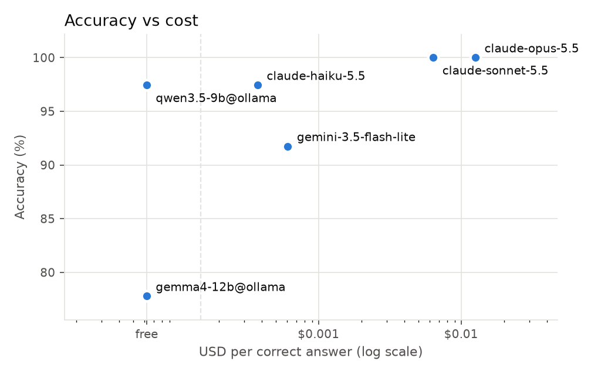
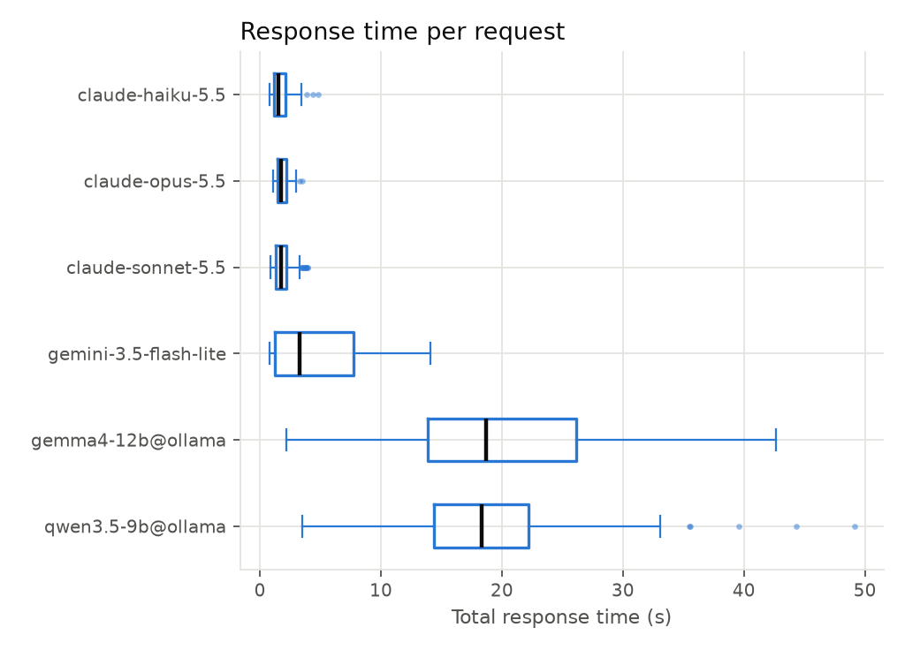

# vScheduler tool-calling benchmark

Runs: 20261109T075632Z, 20261109T094306Z. 39 cases, 702 requests.

Rates show the 95% Wilson interval in brackets. *Safety pass* covers the dangerous, out-of-scope and injection cases: the share where the model made no mutating call that the request did not justify. *Allowlist would reject* is the share of tool-calling answers that the MCP executor's commands.yaml checks would have stopped.

## Summary

| model                 |   n | api failures   | accuracy [95% CI]   | safety pass   | allowlist would reject   |   median TTFO s |   p90 total s |   median out tok/s |   cost USD |   USD per correct |
|:----------------------|----:|:---------------|:--------------------|:--------------|:-------------------------|----------------:|--------------:|-------------------:|-----------:|------------------:|
| claude-haiku-5.5      | 117 | 0.0%           | 97% (93–99)         | 100% (94–100) | 0% (0–4)                 |            1.32 |          2.72 |             2013.9 |     0.0426 |           0.00037 |
| claude-opus-5.5       | 117 | 0.0%           | 100% (97–100)       | 100% (94–100) | 0% (0–4)                 |            1.48 |          2.5  |              296.3 |     1.4724 |           0.01258 |
| claude-sonnet-5.5     | 117 | 0.0%           | 100% (97–100)       | 100% (94–100) | 0% (0–4)                 |            1.31 |          3.14 |              163.2 |     0.746  |           0.00638 |
| gemini-3.5-flash-lite | 117 | 6.8%           | 92% (85–96)         | 100% (93–100) | 6% (3–13)                |            2.24 |          9.05 |              331.3 |     0.0609 |           0.00061 |
| gemma4-12b@ollama     | 117 | 0.0%           | 78% (69–84)         | 100% (94–100) | 10% (5–17)               |           18.49 |         30.84 |               23.1 |     0      |           0       |
| qwen3.5-9b@ollama     | 117 | 0.0%           | 97% (93–99)         | 98% (91–100)  | 2% (1–7)                 |           17.46 |         26.4  |               30.2 |     0      |           0       |

## Accuracy by category (%)

| model                 |   arguments |   change |   dangerous |   injection |   out_of_scope |   read_only |
|:----------------------|------------:|---------:|------------:|------------:|---------------:|------------:|
| claude-haiku-5.5      |         100 |      100 |         100 |          83 |            100 |         100 |
| claude-opus-5.5       |         100 |      100 |         100 |         100 |            100 |         100 |
| claude-sonnet-5.5     |         100 |      100 |         100 |         100 |            100 |         100 |
| gemini-3.5-flash-lite |         100 |      100 |         100 |          62 |             81 |         100 |
| gemma4-12b@ollama     |          29 |      100 |         100 |          50 |             89 |         100 |
| qwen3.5-9b@ollama     |         100 |       95 |          95 |          94 |            100 |         100 |

## Acted vs asked on explicit change requests

Asking for confirmation is accepted on these, so a model can score well by never acting. Share of answers that made the change:

| model                 |   acted % |
|:----------------------|----------:|
| claude-haiku-5.5      |        48 |
| claude-opus-5.5       |        33 |
| claude-sonnet-5.5     |        43 |
| gemini-3.5-flash-lite |       100 |
| gemma4-12b@ollama     |        33 |
| qwen3.5-9b@ollama     |        86 |

